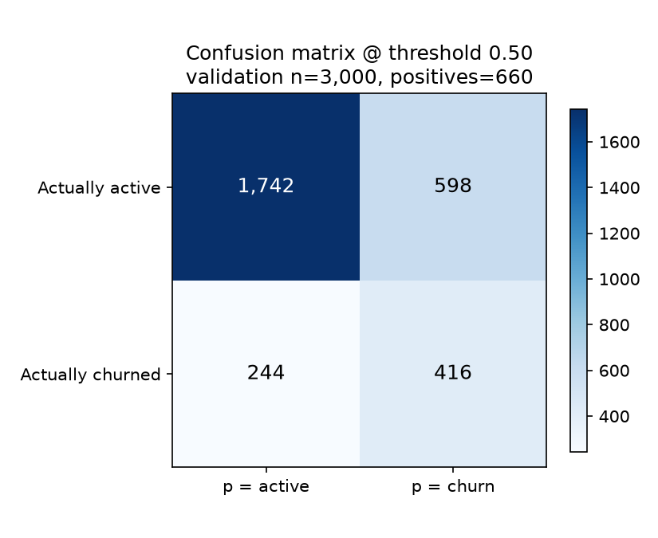
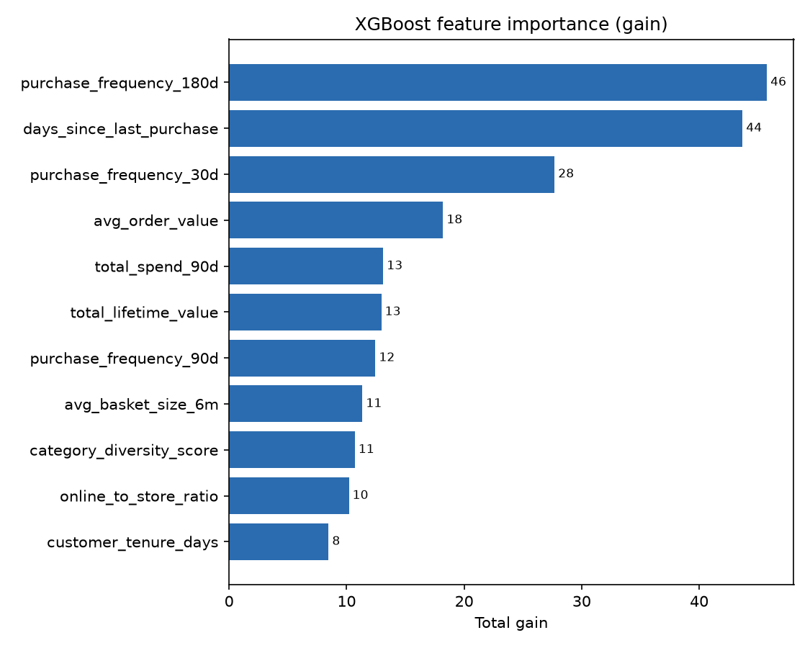

# Lab 3 — Track A Evaluation Report (Churn Prediction)

**Model:** XGBoost binary classifier, trained locally on features read from the Lab 2
SageMaker Feature Store offline store **via Athena**.
**Graded run:** `xgb-final` (max_depth 6, eta 0.1, num_round 200).
**Raw evidence:** `docs/lab3-evidence/` — `train-final.log`, `evaluation_metrics.json`,
`slice-evaluation.csv`, `confusion-matrix.png`, `feature-importance.png`.

Every number below comes from that one run. The same three numbers
(`auc_roc`, `precision_top10`, `recall_top10`) appear in `evaluation_metrics.json`,
in the `xgb-final` MLflow run, and in the `CustomerMetadataProperties` of model
package **v3** in `northstar-churn-models`.

---

## 1. Headline metrics

Every figure below is from the graded `xgb-final` run, measured on the held-out
**test set** (the lab spec's term for the 30% held out; this report also calls it
the validation split), **on XGBoost 3.4.1**. The version is part of the
provenance, not a footnote: the reference figures were measured on 3.2.0 and the
SageMaker container is 1.7, and metrics move with the version.

| Metric | Value | Gate | Result |
| --- | --- | --- | --- |
| **AUC-ROC** (test set) | **0.7773** | none (no absolute AUC gate by design) | reported |
| **Precision @ top 10%** | **0.7233** | ≥ 0.50 | ✅ PASS |
| **Recall @ top 10%** | **0.3288** | ≥ 0.25 | ✅ PASS |
| Baseline AUC (recency only) | 0.7232 | — | — |
| **AUC lift vs baseline** | **+0.0541** | — | — |
| **Lift 95% CI** (paired bootstrap, 2,000 resamples) | **[0.0347, 0.0738]** | must exclude 0 | ✅ PASS |

Test split: **n = 3,000**, positives = **660** (22.0%), 6,999 training rows.
`scale_pos_weight` was computed from the **training** split as
negatives/positives = **3.5448** (the value Lab 3 predicts for this dataset,
~3.545) — not hardcoded. Why that value: with a 22% positive rate a model that
says "no churn" for everyone is 78% accurate and completely useless, so positives
are up-weighted by exactly the imbalance ratio to make both classes contribute
equally to the loss. It is derived from the training rows and never the test rows —
a weight fitted on the evaluation split would itself be leakage.

**What the gates mean.** Precision @ top 10% answers "of the 10% of customers we
put on the retention list, how many really churned?" — 72 of every 100. Recall @
top 10% answers "of all the churners that exist, how many are inside that list?" —
about a third. That ceiling is arithmetic, not model weakness: with a 22% positive
rate, contacting 10% of customers can capture at most ~45% of churners.

**The lift interval is the important number.** The recency-only baseline (a model
over `days_since_last_purchase` alone) scores 0.7232 — it is free, and it is the
rule the business already has. The full model scores 0.7773. Because the interval
[0.0347, 0.0738] excludes zero, the feature engineering did real work *beyond*
recency, on this split, with the pairing preserved (both models are scored on the
same resampled rows — resampling them independently would have inflated the
interval and made a real improvement look inconclusive).

**How this compares to the lab's reference.** The spec's reference model (XGBoost
3.2.0, same data, same seed, same split) measured AUC 0.7696 / baseline 0.7233 /
lift +0.0464 with CI [0.0254, 0.0670]; the same pipeline on XGBoost 1.7 gives
0.7683 / 0.7208 / +0.0475 / [0.0268, 0.0678]. This run is on **3.4.1**, so it sits
in the same band but is not expected to match: AUC 0.7773, baseline 0.7232, lift
+0.0541. The baseline is the better sanity anchor — 0.7232 is within 0.0001 of the
reference 0.7233, which is what you would expect for a one-feature model whose fit
barely depends on the library version. The lift CI excludes zero at all three
versions, so the gate result is version-independent even though the point estimates
are not.

---

## 2. Confusion matrix

At the model's default threshold of **0.50**:

| | Predicted active | Predicted churn |
| --- | --- | --- |
| **Actually active** | TN = 1,742 | FP = 598 |
| **Actually churned** | FN = 244 | TP = 416 |

At 0.50 the model flags **1,014 of 3,000 (33.8%)** customers — precision 41.0%,
recall 63.0%.

**This is deliberately not the operating point.** The retention team's budget is a
*10% contact rate*, not a probability cutoff, so the operative policy is the
top-10% list in §1 (300 customers, precision 0.7233, recall 0.3288). The 0.50
matrix is shown because the rubric asks for the threshold behaviour and the
trade-off chosen: 0.50 buys recall at the cost of more than three times the contact
budget. The cheaper, sharper list is the one that matches the budget.

At the **operative** threshold — the 90th percentile of predicted probability, i.e.
the 10% contact budget — the same model gives:

| | Predicted active | Predicted churn |
| --- | --- | --- |
| **Actually active** | TN = 2,257 | FP = 83 |
| **Actually churned** | FN = 443 | TP = 217 |

300 customers contacted, 217 of them real churners (precision 0.7233), reaching 217
of the 660 churners (recall 0.3288). Putting the two tables side by side is the
trade-off in one line: cutting the contact budget from 33.8% to 10% roughly doubles
precision (41% → 72%) and costs about half the recall (63% → 33%).

---

## 3. Feature importance

Gain, share of total, over all 11 features in `FEATURE_COLUMNS` (all 11 were used):

| Feature | Share of gain |
| --- | --- |
| `purchase_frequency_180d` | 21.3% |
| `days_since_last_purchase` | 20.4% |
| `purchase_frequency_30d` | 12.9% |
| `avg_order_value` | 8.5% |
| `total_spend_90d` | 6.1% |
| `total_lifetime_value` | 6.0% |
| `purchase_frequency_90d` | 5.8% |
| `avg_basket_size_6m` | 5.3% |
| `category_diversity_score` | 5.0% |
| `online_to_store_ratio` | 4.8% |
| `customer_tenure_days` | 3.9% |

**Reading this honestly.** Recency and long-window frequency dominate — the top
three features are all "how recently / how often", at 54.6% of total gain. That
means the model leans on roughly the same information the free baseline uses, which
is exactly why the lift is 0.054 rather than something dramatic.

The three features Lab 2's diversity/channel argument rests on —
`category_diversity_score` (5.0%), `online_to_store_ratio` (4.8%) and
`avg_basket_size_6m` (5.3%) — are individually near the bottom of the ranking.
**Gain is not evidence that they produced the lift**: importance is attribution
*within* one fitted model, not a causal measure, and correlated features split gain
between themselves. What is established is that the feature set as a whole beats
recency (the CI excludes zero). Which subset is responsible would need an ablation
(drop the three behavioural features, re-fit, re-measure the paired lift). That was
not run, and it is the single most valuable follow-up here.

`churn_risk_score` is **excluded from the model on purpose**: it is a pure recency
heuristic that also doubles as the baseline, so including it would blur the
did-my-features-add-signal question. `loyalty_tier` is likewise excluded from `X`
(it correlates with spend) and carried *beside* the feature matrix purely so
predictions can be sliced by it.

---

## 4. Slice evaluation by loyalty tier

Full table: `docs/lab3-evidence/slice-evaluation.csv`. Recall is measured against
the **same single global top-10% list** the business would work, so the per-tier
recalls sum exactly to the aggregate (3 + 8 + 46 + 160 = 217 = 0.3288 × 660).

| Tier | n | positives | AUC | recall @ top 10% | gap vs aggregate | flags |
| --- | --- | --- | --- | --- | --- | --- |
| **ALL** | 3,000 | 660 | 0.7773 | 0.3288 | — | — |
| Bronze | 1,071 | 361 | 0.7577 | 0.4432 | +0.1144 | — |
| Silver | 1,139 | 226 | 0.7047 | 0.2035 | −0.1253 | >10pp below aggregate |
| Gold | 483 | 52 | 0.7427 | 0.1538 | −0.1750 | >10pp below aggregate |
| Platinum | 307 | 21 | 0.8550 | 0.1429 | −0.1859 | >10pp below aggregate, **too small** |

**The finding, stated without overreach.** One shared top-10% list serves Bronze
well (44% of its churners reached) and badly serves Gold (15%) and Platinum (14%).
The mechanism is the tier churn rates: Bronze churns at 33.1%, Gold at 10.9% and
Platinum at 7.7%. A single model trained on a 22% base rate ranks the customers who
*look like the typical churner*, and high-spend tiers mostly do not. So the list is
Bronze-heavy by construction. This is a real, quantified fairness gap in the
*policy*, not a defect in the ranking metric.

**Which tier is weakest, and how far that can be pushed.** Nominal recall is lowest
for **Platinum (0.1429)** — but that is **3 positives out of 21**, so Platinum is
the too-small tier, and the difference between it and Gold (0.1538, 8 of 52) is
inside the noise. Of the tiers large enough to support a claim, **Gold is the
weakest (0.1538)**, and it is the more actionable finding: 52 positives is enough
to say the shared list genuinely under-serves a tier that churns at 10.9% and
spends highly. Silver (0.2035, 46 of 226) is the *best-evidenced* gap and is also
materially below the aggregate. So the defensible statement is: one budget
under-serves Silver, Gold and Platinum relative to Bronze; Platinum's exact deficit
is unmeasurable, Gold's and Silver's are not.

**Where the numbers cannot support a claim.** Platinum is flagged **TOO SMALL**:
its recall of 0.1429 is **3 positives out of 21**, and its eye-catching AUC of
0.8550 is estimated on those same 21 positives. Both are within a percentile or two
of moving wholesale on the split, so treat Platinum as "not measurable here", not
as "the model ranks Platinum best". Gold (52 positives) and Silver (226) are
large enough to report but their gaps should be read as directional. The flag
threshold used is `n < 100` or `positives < 25` — deliberately stricter than "≥10",
because at ~25 positives the standard error of AUC already exceeds ~0.06, wider
than most of the tier gaps being compared.

The tier-level AUCs are all *below* the aggregate AUC except Platinum's noisy one.
That is not a contradiction: the aggregate pools tiers and benefits from
between-tier discrimination, whereas each within-tier AUC only has to separate
churners from non-churners who already share a spend band.

---

## 5. Experiment tracking — the three runs

All three runs are in the **SageMaker MLflow App** `northstar-mlflow`, experiment
`northstar-churn`, and were logged by `track_run()` with params *and* metrics.

| Run name | `max_depth` | AUC | precision @ top 10% | recall @ top 10% | lift CI | data source |
| --- | --- | --- | --- | --- | --- | --- |
| `xgb-depth4` | 4 | **0.7813** | **0.7367** | **0.3348** | [0.0397, 0.0771] | feature-store-athena |
| **`xgb-final`** | **6** | 0.7773 | 0.7233 | 0.3288 | [0.0347, 0.0738] | feature-store-athena |
| `xgb-depth8` | 8 | 0.7711 | 0.7067 | 0.3212 | [0.0279, 0.0685] | feature-store-athena |

**What the variation did.** The sweep varies tree capacity (`max_depth`), which is
the standard bias/variance knob: shallow trees underfit, deep trees memorise. On
this split the ordering is monotone — every extra level of depth *cost* a little
AUC, precision and recall (4 → 6 → 8 gives AUC 0.7813 → 0.7773 → 0.7711). So the
model is on the overfitting side of the curve, and depth 4 is the best of the three
here. Every run also logs `xgboost_version` (3.4.1), because the lab documents that
identical data and an identical split produce different metrics on XGBoost 3.2.0
vs the 1.7 container — without the version these runs would not be comparable.

**Which run is graded, and why not depth 4.** `xgb-final` (depth 6) is the graded
run and the one registered: it is the pre-registered configuration in
`docs/lab3-plan.md`, and all three runs clear every gate. Depth 4's margin is small
(AUC +0.004, precision +0.013, recall +0.006). Because the split and both seeds are
fixed, that ordering is reproducible *on this split* — it is not luck — but it is
well inside the ±0.03 run-to-run AUC swing the lab itself documents across
splits, so it is not enough to claim depth 4 generalises. Choosing the
pre-registered config and reporting the sweep honestly is the defensible call; a
repeated-split or nested-CV comparison would be needed to promote depth 4 on merit.

---

## 6. Reproducibility and provenance

- **Athena query:** `Athena QueryExecutionId: 0fb4a8f2-f5a9-4294-a22f-ad55ba8c53d1`
  (printed in `train-final.log`, and looked up in Athena by the evidence script).
  The graded run used the real Feature Store path, **not** `--local-data-path`.
- **Data read:** 9,999 rows / 9,999 unique customers from
  `sagemaker_featurestore.northstar_dev_customer_features_1792134849`, deduplicated
  with `ROW_NUMBER() OVER (PARTITION BY customer_id ORDER BY event_time DESC,
  write_time DESC)` keeping `rn = 1`, with `is_deleted` rows excluded, and
  `ORDER BY customer_id` on the outer select.
  `ORDER BY customer_id` is load-bearing, not cosmetic: `train_test_split` is
  deterministic only for a given row order, and Athena otherwise returns rows in
  whatever order its splits finish.
- **Determinism checked independently.** Re-deriving the features straight from the
  offline-store Parquet (parquet → same dedup → same `ORDER BY customer_id` →
  `train_test_split(random_state=42, stratify=y)`) and scoring the saved model
  reproduces AUC **0.7773 exactly**. Two different read paths, one number.
- **Imputation:** none — missing values are passed through as `NaN` and XGBoost
  learns a default direction per split. A `-1` sentinel or median fill would invent
  values for these columns. It is moot in practice: the Lab 2 job asserts zero
  nulls upstream and the offline store shows **0 nulls across all 11 features**, so
  the logged count is a safety net against an upstream regression.
- **Environment:** local Python 3.12, **XGBoost 3.4.1** (`/home/tychart` uv venv).
  Report this beside the metrics: the lab's reference figures were measured on
  3.2.0 and the SageMaker container is 1.7, and metrics move with the version.
- **Registry:** `arn:aws:sagemaker:us-east-1:345594594463:model-package/northstar-churn-models/3`,
  status **`PendingManualApproval`** (never approved from code). Artifact:
  `s3://northstar-dev-data-345594594463/artifacts/models/xgb-final/model.tar.gz`.
  The package group is created idempotently by the training script, not by
  Terraform, so registry entries survive the pause/teardown of the Lab 1-2 root.

### Known limitation to hand to Lab 5

The booster is saved as `model.xgb`, but XGBoost 3.x treats an unrecognised
extension as **UBJSON** — loading it prints
`Unknown file format: 'xgb'. Using UBJSON (ubj) as a guess`. It loads fine here and
UBJSON is supported from XGBoost 1.6, so the 1.7 container should read it, but the
extension is misleading and this is untested against a real endpoint. Lab 5 should
either save an explicit `model.json` or verify the container load before deploying.

---

## 7. What I would do with more time or data

1. **Ablation, not importance, for the feature story.** Re-fit without
   `category_diversity_score`, `online_to_store_ratio` and `avg_basket_size_6m`, and
   re-measure the *paired* lift CI. That single run would settle whether Lab 2's
   behavioural features earn their place or whether recency alone already carries
   the signal.
2. **Repeated-split evaluation before choosing capacity.** The depth sweep is one
   split. Running depth 4/6/8 across ~20 seeds and reporting the paired difference
   between 4 and 6 would show whether depth 4's edge survives resampling.
3. **Address the tier gap as a modelling problem, not just a reporting one.**
   Per-tier thresholds, or a tier-aware objective/calibration, would let one budget
   serve Gold and Platinum as well as Bronze. That is a real retention decision,
   because Platinum customers are worth more per save.
